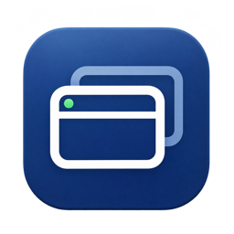
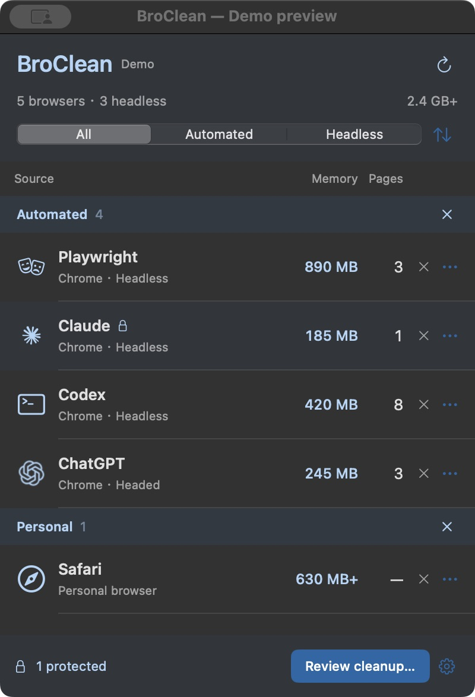
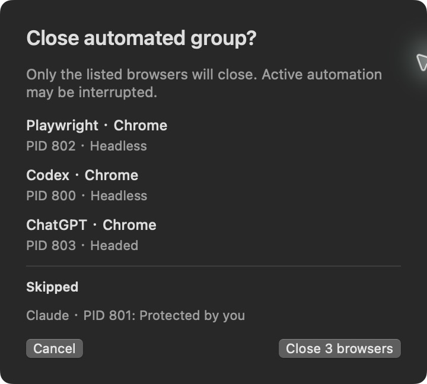

<p align="center">
  
</p>

<h1 align="center">BroClean</h1>

<p align="center">Inspect browser sources, protect active work, and close groups from your menu bar.</p>

<p align="center"><a href="README.md">简体中文</a> · <strong>English</strong></p>

<p align="center">
  <a href="https://github.com/holynova/BroClean/releases/latest"><strong>Download for macOS</strong></a> ·
  <a href="https://github.com/holynova/BroClean/releases/tag/v0.3.0">What's new in 0.3.0</a> ·
  <a href="https://github.com/holynova/BroClean/issues">Report an issue</a>
</p>

<p align="center">macOS 14+ · Apple Silicon download · Native SwiftUI + AppKit</p>

Browsers can keep running after an AI tool or automated test finishes. BroClean brings browser instances, their inferred launch sources, and resource usage into one view, so you can inspect them before deciding what to close.

<p align="center">
  
</p>

*Actual native app screenshot using demo data. The interface is currently in English; demo mode never closes real processes.*

## Get started

1. Download `BroClean-0.3.0-macOS-arm64.zip` from [Releases](https://github.com/holynova/BroClean/releases/latest) and unzip it.
2. Move `BroClean.app` to Applications and open it. Click the BroClean menu-bar icon to see your browsers.
3. Click a source name to inspect its evidence. Use the row's `…` menu to protect instances you want to keep running.

The download requires **Apple Silicon and macOS 14 or later**. Running the app does not require Swift, Node.js, or Python. The current release is locally ad-hoc signed and is not Apple-notarized. A SHA-256 checksum file is included with the release.

## From inspection to cleanup

- **Recognize sources.** Monochrome marks and source labels help you locate instances. Expand a row for inference evidence, launcher details, and process information.
- **Narrow the view.** Filter by All, Automated, or Headless, then sort by memory, page count, age, and more.
- **Protect active work.** Protection persists by process identity and is shared with the CLI. Group and bulk cleanup skip protected instances.
- **Review before closing.** The `×` in each group header opens a list of targets and exclusions. It selects only that group's currently visible instances. Personal-browser groups include an additional warning about interrupting windows and active work.

<p align="center">
  
</p>

*The review lists the instances that will close and explains which ones are skipped.*

Batch operations show progress and let you stop the remaining work. Individual close and force quit are separate actions; a normal close never escalates automatically. A protected instance can still be closed through an explicitly selected individual action.

## Understand the readings

| Reading | Meaning and limits |
| --- | --- |
| Source | Inferred from process ancestry and launch arguments, not an official integration with the named application. |
| Memory | Estimated process-tree RSS, not guaranteed reclaimable memory. `+` means the reading is incomplete. |
| Pages | Read from an accessible, local, process-owned CDP endpoint when available. `—` means unavailable; process counts are never substituted for page counts. |
| Safari | App-level detection. Shared WebKit services are excluded from its memory total, and page counts are unavailable. |

Detection covers Chrome, Chrome for Testing, Chromium, Edge, Firefox, and Safari; available readings vary by browser. Automated bulk cleanup also excludes standard-profile and uncertain instances. Before termination, the app rechecks process identity, ownership, and executable path. BroClean does not perform automatic cleanup or delete browser profiles or user data.

## CLI and source builds

Requires macOS 14+ and the **Swift 6 toolchain**. The desktop app and CLI have no third-party runtime dependencies.

```sh
git clone https://github.com/holynova/BroClean.git
cd BroClean
swift test --disable-xctest
./scripts/build-app.sh
open dist/BroClean.app
```

The CLI shares detection, termination, and protection logic with the app. Inspect the list, then preview a cleanup plan:

```sh
./scripts/build-cli.sh
./dist/broclean list --sort memory --desc
./dist/broclean close --headless --dry-run
```

`--dry-run` reports the plan without sending termination signals. See the [CLI reference](docs/CLI.md) for JSON output, individual targets, and protection commands.

<details>
<summary>Want to explore the interface? Use demo mode</summary>

Quit any running copy of BroClean, then run this from the source checkout after building:

```sh
open dist/BroClean.app --args --demo --preview-window
```

Demo mode uses sample instances. A normal launch reads real local processes.

</details>

## Learn more

- [Architecture](docs/ARCHITECTURE.md) · [Design system](DESIGN.md)
- [0.3.0 release notes](docs/RELEASE-0.3.0.md) · [Validation record](docs/VALIDATION.md)
- [Reproducible browser lab](docs/BROWSER-LAB.md) · [Product behavior](docs/PRODUCT-SPEC.md)

Version 0.3.0 passed **33 Swift Testing tests**, along with Release build, app-signature, and archive verification. Broader system compatibility and long-running behavior still need further validation. Please include your macOS version, browser type, and reproduction steps when [reporting an issue](https://github.com/holynova/BroClean/issues).
