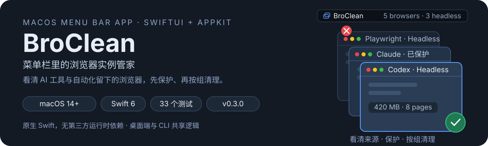
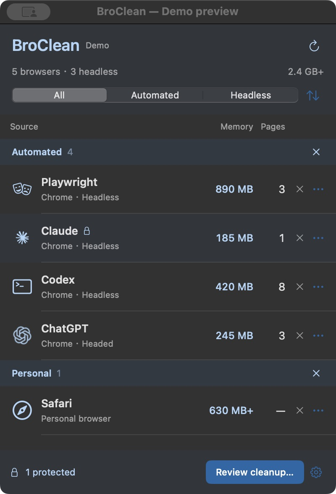
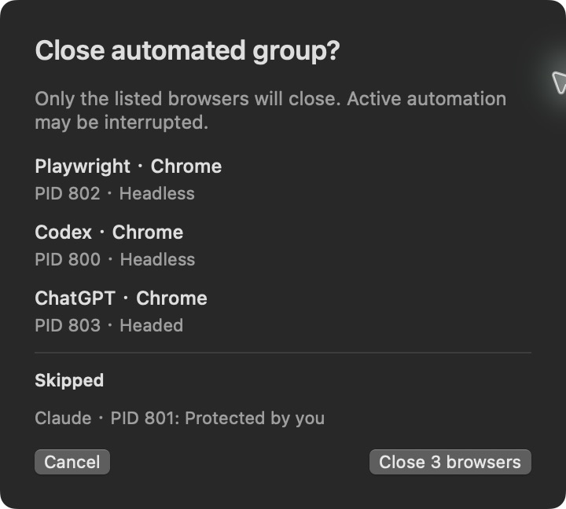

<p align="right"><a href="README.en.md">English</a></p>

<p align="center">
  
</p>

<p align="center">
  <a href="https://github.com/holynova/BroClean/releases/latest"><strong>▶ 下载 macOS 版</strong></a>
  ·
  <a href="https://github.com/holynova/BroClean/releases/tag/v0.3.0">0.3.0 更新说明</a>
</p>

AI 工具或自动化测试结束后，浏览器可能仍在后台运行。BroClean 是原生 macOS 菜单栏应用，把浏览器实例、推断的启动来源和资源占用放在一起：先看清情况，再决定关闭哪些——保护正在使用的实例，按组清理其余的。原生 SwiftUI + AppKit，macOS 14+，Apple Silicon。

## 截图

<p align="center">
  
  
</p>

*真实原生应用截图，使用演示数据。界面目前为英文；演示模式不会关闭真实进程。*

## 从发现到关闭

- **辨认来源**：单色图标与来源名称帮助定位实例；展开详情可查看推断依据、启动器及进程信息。来源按进程关系与启动参数推断，不代表对应应用的官方集成。
- **缩小范围**：在 All、Automated、Headless 之间筛选，按内存、页面数、运行时长等排序。
- **保护工作**：保护状态按进程身份（PID + 内核启动时间）持久保存，并与 CLI 共享；分组及批量清理会跳过保护项。
- **确认再关闭**：点击组标题右侧的 `×`，先查看目标与跳过原因。只处理当前筛选下可见的这一组；个人浏览器组会额外提示可能中断窗口与工作。
- **批量有分寸**：批量执行时可查看进度、停止剩余任务。单实例关闭与强制退出是独立入口；普通关闭不会自动升级为强制退出。保护项仍可通过明确选择的单实例操作关闭。
- **不做多余的事**：不自动清理，不删除浏览器配置或用户数据；发出终止请求前会重新校验进程身份、所属用户与可执行路径。

## 如何理解这些数据

| 显示内容 | 含义与边界 |
| --- | --- |
| 来源名称 | 根据进程关系与启动参数推断，不代表对应应用的官方集成。 |
| 内存 | 进程树 RSS 估计值，不等于关闭后可释放的内存；`+` 表示数据不完整。 |
| 页面数 | 尝试通过本机、进程拥有的 CDP 端点读取；无法读取时显示 `—`，不以进程数冒充页面数。 |
| Safari | 提供应用级识别；共享 WebKit 服务不计入其内存汇总，页面数不可用。 |

识别范围包括 Chrome、Chrome for Testing、Chromium、Edge、Firefox 和 Safari；不同浏览器可提供的数据不同。自动化批量清理还会排除标准配置和不确定的实例。

## 开始使用

1. 从 [Releases](https://github.com/holynova/BroClean/releases/latest) 下载 `BroClean-0.3.0-macOS-arm64.zip`，解压得到 `BroClean.app`。
2. 将应用移入"应用程序"后打开，点击菜单栏中的 BroClean 图标查看列表。
3. 点击来源名称查看识别依据；通过行末的 `…` 菜单保护需要继续运行的实例。

安装包适用于 **Apple Silicon / macOS 14 或更新版本**，运行应用无需安装 Swift、Node.js 或 Python。当前发行版采用本地 ad-hoc 签名，尚未进行 Apple 公证。Release 中附有 SHA-256 校验文件。

## CLI 与源码构建

需要 macOS 14+ 和 **Swift 6 工具链**。桌面端与 CLI 没有第三方运行时依赖。

```sh
git clone https://github.com/holynova/BroClean.git
cd BroClean
swift test --disable-xctest
./scripts/build-app.sh
open dist/BroClean.app
```

CLI 与桌面端共享识别、关闭和保护逻辑。先查看列表，再预览清理范围：

```sh
./scripts/build-cli.sh
./dist/broclean list --sort memory --desc
./dist/broclean close --headless --dry-run
```

`--dry-run` 只输出计划，不发送终止信号。JSON 输出、指定实例操作与保护命令见 [CLI 文档](docs/CLI.md)。

<details>
<summary>只想查看界面？使用演示模式</summary>

先退出正在运行的 BroClean，再从源码构建目录执行：

```sh
open dist/BroClean.app --args --demo --preview-window
```

演示模式使用示例实例；正常启动则读取本机真实进程。

</details>

## 深入了解

- [架构与实现](docs/ARCHITECTURE.md) · [界面设计规范](DESIGN.md)
- [0.3.0 发行说明](docs/RELEASE-0.3.0.md) · [验证记录](docs/VALIDATION.md)
- [可重复的浏览器实验场景](docs/BROWSER-LAB.md) · [产品行为约定](docs/PRODUCT-SPEC.md)

0.3.0 已通过 **33 项 Swift Testing 测试**，并完成 Release 构建、应用包签名及安装包校验。更全面的系统兼容性与长期运行验证仍需持续完善。发现问题时，欢迎通过 [Issues](https://github.com/holynova/BroClean/issues) 提供 macOS 版本、浏览器类型与复现步骤。
